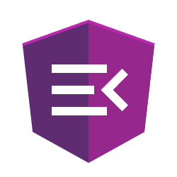

<p align="center" class="intro">
  
</p>

<p align="center" class="intro">
  <a href="https://github.com/fsegurai/ngx-sidenav">
      
  </a>
  <a href="https://github.com/fsegurai/ngx-sidenav/releases/latest">
      
  </a>
  <br>
  
  
  <a href="https://opensource.org/licenses/MIT">
    
  </a>
  <br>
   
  
  <a href="https://www.npmjs.com/package/@fsegurai/ngx-sidenav">
    
  </a>
</p>

`@fsegurai/ngx-sidenav` is an [Angular](https://angular.dev/) side navigation built for documentation sites and
applications: a resizable, collapsible panel with stacked menu levels, custom component levels, search, and native
support for the `manifest.json` and `search-index.json` written by
[`@fsegurai/manifest-generator`](https://github.com/fsegurai/manifest-generator).

### Table of contents

- [Features](#features)
- [Installation](#installation)
- [Configuration](#configuration)
    - [Migrating from 22.0 to 22.1 (Angular Material is no longer required)](#migrating-from-220-to-221-angular-material-is-no-longer-required)
    - [Migrating from 20 to 22](#migrating-from-20-to-22)
- [Usage](#usage)
    - [Menu items](#menu-items)
    - [Item icons](#item-icons)
    - [Menu composition](#menu-composition)
    - [Responsive layout](#responsive-layout)
    - [Programmatic navigation](#programmatic-navigation)
    - [Component stacking](#component-stacking)
    - [Manifest Generator integration](#manifest-generator-integration)
    - [Custom schemas](#custom-schemas)
    - [Search](#search)
    - [Large datasets](#large-datasets)
    - [Lazy levels and resilient sources](#lazy-levels-and-resilient-sources)
    - [Web Worker](#web-worker)
- [Theming](#theming)
- [API reference](#api-reference)
- [Accessibility](#accessibility)
- [Demo application](#demo-application)
- [Contributing](#contributing)
- [License](#license)

## Features

- **Stacked navigation** — parents open a new level; a back row returns.
- **Route-aware restore** — after a reload, and after every navigation from outside the menu (links in the page,
  back/forward, search), the level containing the active route opens, whatever the menu source.
- **Resizable and collapsible** — pointer (mouse, touch, pen) and keyboard resizing, persisted width and state.
- **Component levels** — push any standalone component as a level, with `componentData` set as its inputs.
- **Manifest driven** — `withManifest()` builds the menu from manifest-generator's `manifest.json`, a signal or any
  schema through a mapper.
- **Search** — `withSearchIndex()` and `<ngx-sidenav-search>`: accent-insensitive ranking, heading anchors, WAI-ARIA
  combobox.
- **Lazy levels** — `loadChildren` loads a level on demand (loading row, error row with Retry, cache), and URL
  sources keep their data through failed reloads, with optional retries.
- **Composable panel** — header and footer slots, a row-end template for custom badges, a collapsed icon rail,
  active-row scrolling and back-row context (all opt-in).
- **Responsive** — `mode="side" | "over" | "auto"` switches to an overlay drawer below a breakpoint;
  `collapseOnNavigate` closes it after a page change.
- **No Angular Material, fully restylable** — CDK-only: an accessible overlay tooltip, inline SVG glyphs replaceable
  by templates, an item icon template, ~140 documented CSS variables and stable BEM class hooks.
- **Accessible and translatable** — keyboard support, focus management, live announcements, `SIDENAV_LABELS`.
- **Modern Angular** — signals, standalone components, OnPush, zoneless and SSR-safe.

## Installation

```bash
npm install @fsegurai/ngx-sidenav @angular/router @angular/cdk
# or
bun add @fsegurai/ngx-sidenav @angular/router @angular/cdk
```

| Peer dependency                                                 | Why                                                     |
|-----------------------------------------------------------------|---------------------------------------------------------|
| `@angular/core`, `@angular/common`, `@angular/platform-browser` | Components, signals and `httpResource`                  |
| `@angular/router`                                               | Menu links, route-driven stack and search navigation    |
| `@angular/cdk`                                                  | Focus trap, overlay tooltips, breakpoints, virtual scrolling |
| `rxjs`                                                          | Angular peer                                            |

The built-in glyphs (back arrow, chevron, toggle, external link) are inline SVGs, so no icon font is required. Items
with `iconType: 'material'` (and custom `menuIconExpand` / `menuIconCollapse` ligatures) render as
`<span class="material-symbols-outlined">`; if you use them, load the font once, e.g. in `index.html`:

```html
<link href="https://fonts.googleapis.com/css2?family=Material+Symbols+Outlined" rel="stylesheet"/>
```

Or render every item icon yourself with an [item icon template](#item-icons).

### Compatibility

| Angular | @fsegurai/ngx-sidenav |
|---------|-----------------------|
| 22      | 22.x                  |
| 20      | 20.x                  |

The library is zoneless-compatible and works with `provideZonelessChangeDetection()`.

## Configuration

`provideSidenav()` is optional for a static menu. Use it for labels, manifests and search:

```typescript
import { ApplicationConfig, provideZonelessChangeDetection } from '@angular/core';
import { provideRouter } from '@angular/router';
import { provideSidenav, withManifest, withSearchIndex } from '@fsegurai/ngx-sidenav';
import { routes } from './app.routes';

const mapperOptions = { stripPrefix: 'content/', routePrefix: '/docs' };

export const appConfig: ApplicationConfig = {
  providers: [
    provideZonelessChangeDetection(),
    provideRouter(routes),
    provideSidenav(
      { labels: { back: 'Back to' } },
      withManifest({ source: 'docs/1.0.0/manifest.json', mapperOptions }),
      withSearchIndex({ source: 'docs/1.0.0/search-index.json', mapperOptions }),
    ),
  ],
};
```

| Piece                       | Purpose                                                                          |
|-----------------------------|----------------------------------------------------------------------------------|
| `provideSidenav(config, …)` | Environment providers. `config.labels` overrides the English labels.             |
| `withManifest(options)`     | Root menu from a manifest. See [Manifest Generator](#manifest-generator-integration). |
| `withSearchIndex(options)`  | Search index. See [Search](#search).                                             |
| `provideSidenavLabels()`    | Same as `config.labels`, also usable in component `providers`.                   |

Only one feature of each kind is allowed. `HttpClient` is provided in root by Angular 22; add `provideHttpClient()`
only to configure it (interceptors are honored).

### Labels

Every text rendered or announced is in `SidenavLabels` (`toggleExpand`, `toggleCollapse`, `navigation`, `back`,
`resizeHandle`, `levelAnnouncement`, `opensInNewTab`, `deprecated`, `searchLabel`, `searchPlaceholder`,
`searchNoResults`, `searchIndexing`, `searchResultsCount`, `loading`, `loadError`, `retry`, and the optional `rail`,
the name of the collapsed icon rail, which falls back to `navigation`). `levelAnnouncement` and `searchResultsCount` accept a template
(`'{label} menu'`, `'{count} results'`) or a function.

```typescript
providers: [provideSidenavLabels({ back: 'Atrás', searchResultsCount: (n) => `${n} resultados` })]
```

### Migrating from 22.0 to 22.1 (Angular Material is no longer required)

`@angular/material` is no longer a peer dependency: the library only needs `@angular/cdk`. Keep Material installed
only if your app uses it.

| Before (22.0.0)                                                 | Now (22.1.0)                                                                            |
|-----------------------------------------------------------------|-----------------------------------------------------------------------------------------|
| `MatTooltip` on rows and the resize handle                      | `SidenavTooltip` (CDK overlay, `.ngx-sidenav-tooltip`), styled by `--ngx-sidenav-tooltip-*` |
| `<mat-icon>` for the back arrow, chevron, toggle and external link | Inline `<svg>` (same class names: `ngx-sidenav-menu__icon`, `ngx-sidenav__toggle-icon`, `ngx-sidenav-link__external-icon`) |
| `<mat-icon>` for `iconType: 'material'` items                   | `<span class="ngx-sidenav-menu__icon material-symbols-outlined">`                        |
| `menuIconCollapse` / `menuIconExpand` defaulted to `menu_open` / `menu` | Default `undefined` (built-in SVGs); a value still renders that Material Symbols ligature |
| Active row: `border-left-color-active` on the row border        | An indicator (`::before`) drawn over the rail; same look by default                     |

1. Remove `@angular/material` from your dependencies if nothing else uses it; Material theme bridges written only for
   the sidenav tooltip or icons can go.
2. Update custom styles or tests that targeted `mat-icon`, `.mat-mdc-tooltip` or `MatTooltip`. Tooltip panels render in
   the CDK overlay container: set `--ngx-sidenav-tooltip-*` on `:root`.
3. Load the Material Symbols font only if you use `iconType: 'material'` or ligature toggle icons.
4. Rename `--ngx-sidenav-content-background-color[-hover]` to `--ngx-sidenav-scrollbar-thumb-color[-hover]` (the old
   names still work as fallbacks).
5. If you adopt the new `mode="over"` / `mode="auto"`, the overlay host is `position: fixed` (`.ngx-sidenav--over`);
   the default `mode="side"` keeps the previous layout.

Everything else is additive: [CSS variables](#theming), [class hooks and icon templates](#theming),
[responsive layout](#responsive-layout), factory `withManifest(() => …)` / `withSearchIndex(() => …)` and the manifest
page helpers. Step by step: [22.0 to 22.1 migration guide](docs/22.1.0/content/migration/22-0-to-22-1.md).

### Migrating from 20 to 22

1. Update Angular to 22 and install the new peers: `@angular/router`, `@angular/cdk` (22.0.0 also required
   `@angular/material`; 22.1.0 and later do not).
2. If you swapped `(opened)` and `(closed)` to compensate for the old behavior, swap them back.
3. Call `isSlidingInFromLeft()` / `isSlidingInFromRight()`: they are signals now.
4. Update custom styles and tests that targeted the old item, title, toggle or resize-handle markup (see below).
5. If you call `restoreStackFromStorage()` yourself, pass the root items (`restoreStackFromStorage(rootItems)`); do not
   read or write `localStorage['ngx-sidenav-stack']` directly, its format changed.
6. Optionally replace a hand-written menu with `[items]` or a generated manifest.

| Before (20.x)                                                  | Now (22.x)                                                         |
|----------------------------------------------------------------|--------------------------------------------------------------------|
| `opened` fired on collapse, `closed` on expand                 | `opened` fires on expand, `closed` on collapse                     |
| `isSlidingInFromLeft` / `isSlidingInFromRight` were booleans   | Read-only signals                                                  |
| Items without a route rendered as empty links                  | Buttons; parents and the back row are buttons too                  |
| Title items were links and could pop the stack                 | Non-interactive text                                               |
| Disabled links kept their `href`                               | `aria-disabled`, no `href`                                         |
| The resize handle itself was the focus target                  | `hr.ngx-sidenav__resize-indicator`; the panel is a `<nav>`         |
| Escape always collapsed the panel                              | Escape collapses only in backdrop (modal) mode                     |
| `componentData` was ignored                                    | Each entry is set as an input; other keys are skipped with a warning |
| `initialWidth` overrode the width chosen by the user           | The persisted width wins (clamped); a first visit starts expanded  |
| `restoreStackHybrid()` replaced an existing stack              | It only fills an empty stack                                       |
| Route restore ignored the base href                            | The route comes from `Location.path()`                             |
| A route not in the menu reset the stack to the root            | The levels shown before (or saved by the last visit) are kept      |
| The stored stack held the menu items (`SerializableStackItem`) | It holds level keys (`{ "v": 2, "levels": [...] }`), migrated once |

The full list is in the [CHANGELOG](CHANGELOG.md).

## Usage

### Menu items

```typescript
import { ChangeDetectionStrategy, Component } from '@angular/core';
import { RouterOutlet } from '@angular/router';
import { Sidenav, type StackMenuItem } from '@fsegurai/ngx-sidenav';

@Component({
  selector: 'app-root',
  imports: [Sidenav, RouterOutlet],
  changeDetection: ChangeDetectionStrategy.OnPush,
  template: `
    <div class="layout">
      <ngx-sidenav [items]="menu" [minWidth]="200" [maxWidth]="420" />
      <main><router-outlet /></main>
    </div>
  `,
  styles: `.layout { display: flex; min-height: 100vh; } main { flex: 1 1 0; min-width: 0; }`,
})
export class App {
  protected readonly menu: StackMenuItem[] = [
    { label: 'Workspace', isTitle: true },
    { label: 'Dashboard', icon: 'dashboard', iconType: 'material', route: '/dashboard' },
    {
      label: 'Settings',
      icon: 'settings',
      iconType: 'material',
      isParent: true,
      children: [
        { label: 'Profile', route: '/settings/profile' },
        { label: 'Security', route: '/settings/security', badge: 'New', badgeColor: 'function' },
      ],
    },
    { label: 'GitHub', externalUrl: 'https://github.com/fsegurai/ngx-sidenav' },
  ];
}
```

`<ngx-sidenav>` renders its own menu: pass items through `[items]`, a manifest or `SidenavService` (the only content it
accepts are [icon and glyph templates](#item-icons)). Root menu precedence: the `items` input, then `withManifest()`, then
the service stack.

**Route-aware restore.** The stack follows the router, the same way for every source (`[items]`, a manifest that
resolves after the first render, or a root pushed through `SidenavService`):

- After a reload, and after each navigation (`NavigationEnd`: links in the page, back/forward, search), the level that
  contains the active route opens, its parents stacked below. On reload, `/settings/security` opens the Settings level.
- A navigation to a route already listed in the level shown keeps that level.
- When no item matches the route, the levels shown before (or saved by the previous visit) are kept while they still
  exist in the menu, otherwise the root is shown.
- Component levels pushed on top (component stacking) stay on top; the expanded state and width are persisted.

### Item icons

By default `iconType: 'svg'` renders an `` and `iconType: 'material'` a Material Symbols ligature. To use your own
icon set, place an `ngxSidenavItemIcon` template inside `<ngx-sidenav>` (or `<ngx-sidenav-menu>`); it renders the icon
of every item that has an `icon`:

```html
<ngx-sidenav [items]="menu">
  <ng-template ngxSidenavItemIcon let-item>
    <app-icon [name]="item.icon" aria-hidden="true" />
  </ng-template>
</ngx-sidenav>
```

Import `SidenavItemIcon` next to `Sidenav`. The context is the item (`let-item`, also `let-item="item"`); keep the
icon decorative, the label already names the item.

### Menu composition

Opt-in pieces for a richer menu (all off by default; the menu renders as before without them):

```html
<ngx-sidenav [items]="menu" [search]="true" collapsedMode="rail" [scrollToActive]="true" [backContext]="true">
  <header ngxSidenavHeader>
    <app-project-badge /> <app-version-picker />
  </header>

  <ng-template ngxSidenavItemIcon let-item><app-icon [name]="item.icon" aria-hidden="true" /></ng-template>

  <ng-template ngxSidenavItemEnd let-item>
    @if (item.deprecated) { <span class="badge badge--warn">Deprecated</span> }
    @if (item['status'] === 'new') { <span class="badge">New</span> }
    @if (item.children?.length) { <span class="count">{{ item.children?.length }}</span> }
  </ng-template>

  <footer ngxSidenavFooter>Last updated Nov 18 · <a href="…">Edit page</a></footer>
</ngx-sidenav>
```

| Piece                    | What it does                                                                                         |
|--------------------------|------------------------------------------------------------------------------------------------------|
| `[ngxSidenavHeader]`     | Projected above the search box and the menu; hidden while collapsed (`--ngx-sidenav-header-padding`) |
| `[ngxSidenavFooter]`     | Projected after the menu, pinned to the bottom of the panel; hidden while collapsed (`--ngx-sidenav-footer-padding`, `-border-color`, `-background-color`) |
| `ngxSidenavItemEnd`      | Renders the end of every row (before the chevron of a parent) **instead of** the built-in badges, the deprecated one included |
| `collapsedMode="rail"`   | Collapsed, the panel shows the icons of the current level's items (titles become separators, items without an icon are skipped); a leaf navigates, a parent expands the sidenav and opens its level. Side layout only: the overlay keeps the strip |
| `scrollToActive`         | Scrolls the active row into view after the items render and after each navigation (instant under `prefers-reduced-motion`), the virtual viewport included |
| `backContext`            | The back row shows the title of the level it returns to under its label                              |

Rail tokens: `--ngx-sidenav-rail-width` (`52px`), `--ngx-sidenav-rail-offset` (`48px` below the toggle),
`--ngx-sidenav-rail-gap` (`4px`), `--ngx-sidenav-rail-item-size` (`36px`),
`--ngx-sidenav-rail-item-background-color-hover` and `-active`; the icon size follows `--ngx-sidenav-menu-icon-size`.
Import `SidenavHeader`, `SidenavFooter` and `SidenavItemEnd` next to `Sidenav`.

### Responsive layout

```html
<ngx-sidenav [items]="menu" mode="auto" handsetQuery="(max-width: 999.98px)" [collapseOnNavigate]="true" />
```

| Input                | Default                    | Effect                                                                          |
|----------------------|----------------------------|---------------------------------------------------------------------------------|
| `mode`               | `'side'`                   | `side`: next to the content (as before). `over`: fixed overlay with a backdrop, focus trap and Escape. `auto`: `over` while `handsetQuery` matches, `side` otherwise |
| `handsetQuery`       | `'(max-width: 959.98px)'`  | Media query of `auto` (observed with the CDK `BreakpointObserver` only in `auto`) |
| `collapseOnNavigate` | `false`                    | Collapses the overlay after each router navigation; ignored in `side`          |

Entering the overlay collapses the panel; leaving it restores the expanded state it had before. The overlay host gets
the `ngx-sidenav--over` class (`position: fixed`, `--ngx-sidenav-over-inset-block`, `--ngx-sidenav-over-z-index`,
`--ngx-sidenav-over-background-color`); override its position with your own host selector, e.g. to start below a
header.

### Programmatic navigation

`SidenavService` is provided in root:

```typescript
import { inject } from '@angular/core';
import { SidenavService } from '@fsegurai/ngx-sidenav';

const sidenav = inject(SidenavService);

await sidenav.push({ type: 'menu', title: 'Reports', items: [{ label: 'Monthly', route: '/reports/monthly' }] });
await sidenav.pop();
sidenav.toggleSidenav();
sidenav.setSidenavWidth(320);
```

### Component stacking

Push any standalone component as a level. Each `componentData` entry is set with `ComponentRef.setInput()`; keys
that are not inputs are skipped with a warning.

```typescript
@Component({ selector: 'app-project-filters', template: `Filters for {{ projectId() }}` })
export class ProjectFilters {
  readonly projectId = input.required<number>();
}

// In the page that shows the level
constructor() {
  const sidenav = inject(SidenavService);
  afterNextRender(() => {
    const top = sidenav.stack().at(-1);
    // Already shown (e.g. the page was re-entered): do not stack it twice
    if (top && isComponentStackItem(top) && top.component === ProjectFilters) return;
    void sidenav.push({
      type: 'component',
      component: ProjectFilters,
      componentData: { projectId: 42 },
      title: 'Project filters', // label of the back row above the component
    });
  });
}
```

A component level shows the toggle and a back row (labelled with its `title`) above the component, and it stays
while links inside it navigate, until the back row is used. Do not pop it when the page is destroyed: following one
of its links destroys the page, and the sidenav would fall back to the previous (often the root) menu. Root items
that resolve or change later (a manifest, the `items` input) keep component levels on top. Component levels are not
saved to `localStorage`; menu levels are, by reference (the route or label of the item each level was opened
from), and rebuilt from the live root items on the next visit.

### Manifest Generator integration

1. Write Markdown pages with front-matter (`label`, `order`, `icon`, `badge`, …).
2. Generate the files:

   ```bash
   manifest-generator --route ./docs/1.0.0/content --output ./docs/1.0.0
   ```

3. Provide the manifest and leave `items` unset (`<ngx-sidenav />`):

   ```typescript
   provideSidenav(
     {},
     withManifest({
       source: 'docs/1.0.0/manifest.json',
       mapperOptions: { stripPrefix: 'content/', routePrefix: '/docs' },
     }),
   );
   ```

| Option                        | Effect                                                                               |
|-------------------------------|--------------------------------------------------------------------------------------|
| `source`                      | A URL (fetched with `httpResource`), a signal (`undefined` = not ready) or an array  |
| `mapperOptions.stripPrefix`   | Removes a leading part of every route, e.g. `content/`                              |
| `mapperOptions.routePrefix`   | Prefix (string) or function applied after `stripPrefix`: `content/a` → `/docs/a`     |
| `mapper`                      | Replaces the default `fromManifestGenerator` mapper                                  |
| `childrenSource`              | Split manifests: URL of the manifest holding an item's children (lazy level)         |
| `retry`                       | `{ attempts, delayMs }`: retries of a transient failure with backoff (off by default) |

Options that need `inject()` (the current project or version, a service signal) are given as a factory, evaluated
once in an injection context of the injector that registers `provideSidenav()`. Both `withManifest()` and
`withSearchIndex()` accept it:

```typescript
provideSidenav(
  {},
  withManifest(() => ({ source: inject(DocsService).manifest, mapperOptions: { routePrefix: inject(DOCS_BASE) } })),
  withSearchIndex(() => ({ source: inject(DocsSearch).entries, mapper: (entries) => entries, limit: 10 })),
);
```

Items are sorted by `order`; `breadcrumbTitle`, `publishedAt` and `updatedAt` are copied; absolute `redirect`s and
`externalUrl`s are kept. `SidenavManifestService` exposes
`items`, `status` (`idle` · `loading` · `refreshing` · `resolved` · `error`), `error` and `reload()`. A failed reload
keeps the last good items (`status` stays `resolved`, `error` is set).

**Page helpers.** Pure functions over mapped items (`SidenavManifestService.items()` or a mapper result) for the page
around the sidenav:

```typescript
const items = manifest.items() ?? [];
const page = findManifestItem(items, router.url); // the item of a route, at any depth (page?.updatedAt)
const { previous, next } = adjacentItems(items, router.url); // reading order: depth-first, internal pages only
const crumbs = breadcrumbFor(items, router.url); // the item's breadcrumb, or its ancestors (breadcrumbTitle ?? label)
```

Routes are compared without leading/trailing slashes, query string or hash; external items are never matched, and lazy
levels that were not loaded are not searched.

### Custom schemas

Both features accept a `mapper` for any other schema:

```typescript
interface BookChapter { title: string; slug: string; sections?: BookChapter[] }

const toItems = (chapters: BookChapter[]): StackMenuItem[] =>
  chapters.map((chapter) => ({
    label: chapter.title,
    route: `/book/${chapter.slug}`,
    children: chapter.sections && toItems(chapter.sections),
  }));

provideSidenav(
  {},
  withManifest<BookChapter[]>({ source: 'book.json', mapper: toItems }),
  withSearchIndex<BookChapter[]>({
    source: 'book.json',
    mapper: (chapters) => chapters.map((c) => ({ label: c.title, route: `/book/${c.slug}` })),
  }),
);
```

A mapper that throws sets the feature `status` to `error`. `fromManifestGenerator()`, `fromManifestGeneratorLazy()` (the
default of `withManifest()`: children mapped on first read) and `fromManifestSearchIndex()` are exported for
post-processing inside your own mapper.

### Search

```typescript
withSearchIndex({ source: 'docs/1.0.0/search-index.json', mapperOptions, limit: 10, minQueryLength: 2, debounceMs: 150 })
```

| Option           | Default | Description                                                                          |
|------------------|---------|--------------------------------------------------------------------------------------|
| `limit`          | `10`    | Maximum number of results                                                            |
| `minQueryLength` | `2`     | Shorter queries (trimmed) return no results                                          |
| `debounceMs`     | `150`   | Delay between the last keystroke and the query; `0` queries synchronously            |
| `retry`          | off     | `{ attempts, delayMs }`: retries of a transient failure with exponential backoff     |

```html
<!-- inside the panel -->
<ngx-sidenav [search]="true" />

<!-- or anywhere else; [shortcut]="true" makes Ctrl+K / Cmd+K focus it -->
<ngx-sidenav-search [shortcut]="true" (navigated)="onResult($event)" />
```

**Shortcut coexistence.** `shortcut` is off by default, so the box never takes Ctrl/Cmd+K unless asked (no binding
needed). When enabled, it listens on `document` and skips any event whose `defaultPrevented` is already `true`: an
app-wide search that handles Ctrl/Cmd+K first (a capture listener, or a listener on an inner element) and calls
`preventDefault()` keeps the shortcut.

- Ranking by field: label, headings, tags and keywords, description, excerpt. Case- and accent-insensitive.
- A heading match navigates to `route#anchor`, built with `slugifyHeading()` (the same ids as `@fsegurai/ngx-markdown`
  `[headingIds]`).
- Absolute result routes open in a new tab.
- `SidenavSearchService` exposes `query`, `results`, `pending`, `entries`, `status`, `error`, `setQuery()`,
  `search(query)` and `reload()` for custom UIs. `status()` is `indexing` while a large index is built in the
  background (the box shows the `searchIndexing` label); `pending()` is `true` while the results do not answer the
  current query yet (debounce, chunked scan).

### Large datasets

Menus with tens of thousands of items stay responsive:

- `withManifest()` maps only the root level up front; deeper levels are mapped when opened.
- The routes of the root menu are indexed in the background, in small chunks that yield to the browser, so the root
  level renders right away. `SidenavService.routeIndexReady` tells when the index is complete; a route deep in the
  menu is opened as soon as the index reaches it.
- The stored stack only holds level keys (a few hundred bytes), and writes are batched when the browser is idle.
- Menu items are treated as immutable: after changing items in place (`children.push(…)`), call
  `SidenavService.reindex()`.
- The search index is normalized right after it loads (in background chunks above 2000 entries), queries are
  debounced, and indexes above 5000 entries are scanned in chunks; a newer query cancels a stale one.

A custom `mapper` may return the whole tree: it is indexed the same way. Prefer stable `route`s on parent items, so
stored levels and route syncs find them even when labels change.

Measured on 100k menu items and 50k search entries:

| Operation | Before | After |
|-----------|--------|-------|
| Root menu available | 40–109 ms, blocking | ≤ 1.1 ms |
| Route lookup on navigation | 2–7 ms | ≤ 0.06 ms |
| Stack save | 20–60 ms, 6.2 MB | < 4 KB, idle-time write |
| Search: first keystroke | ~205 ms, blocking | ~10 ms |
| Search queries `a` / `al` / `alp` | 54 / 44 / 41 ms | 7.8 / 10.3 / 12.3 ms |

Recommended settings by dataset size, benchmarks (`bun run bench:lib`) and the demo stress test page (`/stress`) are
in the [Performance and Large Datasets guide](docs/22.2.0/content/guides/performance.md).

### Lazy levels and resilient sources

A parent item can load its children when it is opened:

```typescript
{ label: 'API', route: '/api', loadChildren: (signal) => fetch('/api/menu.json', { signal }).then((r) => r.json()) }
```

- `loadChildren(signal?)` returns a `Promise` or an `Observable` of `StackMenuItem[]`. The level shows a loading row
  (`aria-busy`, announced politely), then the items, or an error row with a Retry button.
- Results are cached per item and concurrent requests are shared; leaving the level before it resolves aborts `signal`.
- A route under a lazy parent is found after a reload: the deepest lazy parent whose `route` prefixes it is loaded
  first (up to 8 nested levels). Stored levels work the same way.
- `withManifest({ childrenSource: (item) => url })` splits a manifest into one file per section.
- URL sources keep the last good data when a reload fails (`status` stays `resolved`, `error` is set), report
  `refreshing` while reloading, and retry transient failures (network, 408, 429, 5xx) with `retry: { attempts, delayMs }`.

See the [Lazy Levels guide](docs/22.2.0/content/guides/lazy-levels.md).

### Web Worker

Large search indexes can be built and scanned off the main thread. Create a worker file:

```typescript
// search.worker.ts
import { exposeSidenavWorker } from '@fsegurai/ngx-sidenav/worker';

exposeSidenavWorker();
```

and pass its factory to `withSearchIndex()`:

```typescript
withSearchIndex({
  source: '/docs/search-index.json',
  mapperOptions,
  worker: () => new Worker(new URL('./search.worker', import.meta.url), { type: 'module' }),
})
```

- The worker is only used for indexes above 2000 entries; smaller ones are searched synchronously.
- The source is still loaded and mapped on the main thread (interceptors, `retry`, `reload()` and `entries()` keep
  working), then the mapped entries are copied to the worker once. A custom `mapper` runs on the main thread too.
- `status`, `pending`, debounce and cancellation behave as without the worker; `search()` (synchronous) builds a
  main-thread index on first use.
- Without `Worker` (server rendering, unit tests), when the factory throws (e.g. a CSP), or when the worker fails, the
  search falls back to the chunked main-thread path (a warning is logged once in dev mode). The worker is terminated
  when the application is destroyed.
- `ngx-sidenav/worker` does not import Angular, so the worker bundle only contains the search core. With the Angular
  CLI, set `webWorkerTsConfig` (a tsconfig with `"lib": ["es2022", "webworker"]`) to type-check the worker file.

See the [Web Worker guide](docs/22.2.0/content/guides/web-worker.md).

## Theming

The sidenav and its search box ship light and dark defaults (WCAG AA text contrast in both). The scheme is chosen by:

1. an ancestor with `.dark-theme` / `[data-theme='dark']` or `.light-theme` / `[data-theme='light']`;
2. otherwise `--ngx-sidenav-color-scheme` (`light`, `dark` or `light dark`) when set;
3. otherwise the page `color-scheme`, so `:root { color-scheme: light dark; }` follows `prefers-color-scheme`.

**Dark-mode hook.** Map your app's theme class to the scheme instead of overriding colors one by one:

```css
.app-dark-mode { --ngx-sidenav-color-scheme: dark; }
.app-light-mode { --ngx-sidenav-color-scheme: light; }
```

The defaults use the CSS `light-dark()` function; browsers without it get the light values. Every color and spacing
is also a CSS custom property, which wins over the defaults. Set them on any ancestor (`:root`, a theme class):

```css
.dark-theme {
  --ngx-sidenav-container-background-color: #1e1e2e;
  --ngx-sidenav-link-item-text-color: #cdd6f4;
  --ngx-sidenav-link-item-text-color-active: #89b4fa;
  --ngx-sidenav-link-item-border-left-color-active: #89b4fa;
  --ngx-sidenav-focus-ring: #89b4fa;
}
```

Every variable the library reads is listed below with its default. "theme `x`" is the light/dark token `x` (table
after this one); "`--a`, then …" means the variable falls back to `--a` first. Set them on any ancestor (`:root`, a
theme class); the tooltip panel lives in the CDK overlay container, so set the `tooltip-*` variables on `:root`.

<details>
<summary>CSS variables (142) and defaults</summary>

| Variable | Default | Used by |
|---|---|---|
| `--ngx-sidenav-color-scheme` | — | Sidenav |
| `--ngx-sidenav-min-width` | `30px` | Sidenav |
| `--ngx-sidenav-max-width` | `600px` | Sidenav |
| `--ngx-sidenav-font-family` | `inherit` | Sidenav |
| `--ngx-sidenav-padding-inline` | `1rem` | Sidenav |
| `--ngx-sidenav-padding-block` | `2rem` | Sidenav |
| `--ngx-sidenav-expanded-min-width` | `250px` | Sidenav |
| `--ngx-sidenav-toggle-icon-color` | theme `text` | Sidenav |
| `--ngx-sidenav-over-inset-block` | `0` | Sidenav |
| `--ngx-sidenav-over-z-index` | `1000` | Sidenav |
| `--ngx-sidenav-over-background-color` | `--ngx-sidenav-container-background-color`, then theme `surface` | Sidenav |
| `--ngx-sidenav-container-background-color` | theme `surface` | Sidenav |
| `--ngx-sidenav-text-color` | theme `text` | Sidenav |
| `--ngx-sidenav-scrollbar-thumb-color` | `--ngx-sidenav-content-background-color`, then theme `scrollbar` | Sidenav |
| `--ngx-sidenav-content-background-color` | theme `scrollbar` | Sidenav |
| `--ngx-sidenav-scrollbar-thumb-color-hover` | `--ngx-sidenav-content-background-color-hover`, then theme `scrollbar-hover` | Sidenav |
| `--ngx-sidenav-content-background-color-hover` | theme `scrollbar-hover` | Sidenav |
| `--ngx-sidenav-toggle-top` | `45px` | Sidenav |
| `--ngx-sidenav-toggle-padding` | `5px` | Sidenav |
| `--ngx-sidenav-toggle-background-color` | theme `toggle` | Sidenav |
| `--ngx-sidenav-toggle-border-color` | theme `toggle-border` | Sidenav |
| `--ngx-sidenav-toggle-border-radius` | `20px` | Sidenav |
| `--ngx-sidenav-toggle-box-shadow` | `0 2px 8px rgba(0, 0, 0, 0.1)` | Sidenav |
| `--ngx-sidenav-toggle-background-color-hover` | theme `toggle-hover` | Sidenav |
| `--ngx-sidenav-toggle-box-shadow-hover` | `0 4px 16px rgba(0, 0, 0, 0.15)` | Sidenav |
| `--ngx-sidenav-toggle-border-color-hover` | theme `accent` | Sidenav |
| `--ngx-sidenav-toggle-outline-color` | `--ngx-sidenav-focus-ring`, then theme `accent` | Sidenav |
| `--ngx-sidenav-focus-ring` | theme `accent` | Sidenav |
| `--ngx-sidenav-toggle-icon-size` | `24px` | Sidenav |
| `--ngx-sidenav-backdrop-color` | `rgba(0, 0, 0, 0.32)` | Sidenav |
| `--ngx-sidenav-resize-handle-icon-outline-color` | `--ngx-sidenav-focus-ring`, then theme `accent` | Sidenav |
| `--ngx-sidenav-resize-handle-indicator-background-color` | theme `accent` | Sidenav |
| `--ngx-sidenav-resize-handle-icon-indicator-background-color` | theme `accent` | Sidenav |
| `--ngx-sidenav-resize-handle-icon-indicator-border-color` | theme `accent` | Sidenav |
| `--ngx-sidenav-resize-handle-icon-indicator-color` | theme `surface` | Sidenav |
| `--ngx-sidenav-resize-handle-indicator-background-color-hover` | theme `accent` | Sidenav |
| `--ngx-sidenav-resize-handle-icon-indicator-background-color-hover` | theme `toggle-hover` | Sidenav |
| `--ngx-sidenav-resize-handle-icon-indicator-border-color-hover` | theme `accent` | Sidenav |
| `--ngx-sidenav-resize-handle-icon-indicator-color-hover` | theme `text` | Sidenav |
| `--ngx-sidenav-resize-handle-indicator-line-background-color` | theme `scrollbar` | Sidenav |
| `--ngx-sidenav-resize-handle-icon-indicator-line-background-color` | theme `toggle` | Sidenav |
| `--ngx-sidenav-resize-handle-icon-indicator-line-border-color` | theme `toggle-border` | Sidenav |
| `--ngx-sidenav-resize-handle-icon-border-radius` | `16px` | Sidenav |
| `--ngx-sidenav-resize-handle-icon-indicator-line-color` | theme `text-muted` | Sidenav |
| `--ngx-sidenav-item-radius` | `4px` | Menu |
| `--ngx-sidenav-link-item-text-color-hover` | theme `accent` | Menu |
| `--ngx-sidenav-link-item-text-color-active` | theme `accent` | Menu |
| `--ngx-sidenav-link-item-text-color` | theme `text` | Menu |
| `--ngx-sidenav-link-item-border-left-color` | `--ngx-sidenav-rail-color`, then theme `line` | Menu |
| `--ngx-sidenav-rail-color` | theme `line` | Menu |
| `--ngx-sidenav-menu-back-background-color` | `inherit` | Menu |
| `--ngx-sidenav-menu-back-blur` | `10px` | Menu |
| `--ngx-sidenav-menu-viewport-padding` | `8px 0` | Menu |
| `--ngx-sidenav-menu-icon-size` | `20px` | Menu |
| `--ngx-sidenav-menu-icon-box-size` | `24px` | Menu |
| `--ngx-sidenav-menu-badge-font-size` | `11px` | Menu |
| `--ngx-sidenav-menu-badge-font-weight` | `600` | Menu |
| `--ngx-sidenav-menu-badge-padding` | `2px 6px` | Menu |
| `--ngx-sidenav-menu-badge-border-radius` | `4px` | Menu |
| `--ngx-sidenav-menu-badge-text-transform` | `capitalize` | Menu |
| `--ngx-sidenav-menu-badge-theme-color` | theme `text` | Menu |
| `--ngx-sidenav-menu-badge-deprecated-color` | theme `warning` | Menu |
| `--ngx-sidenav-item-height` | `48px` | Menu |
| `--ngx-sidenav-link-item-font-size` | `inherit` | Rows |
| `--ngx-sidenav-link-item-font-weight` | `inherit` | Rows |
| `--ngx-sidenav-link-item-line-height` | `inherit` | Rows |
| `--ngx-sidenav-link-item-margin-left` | `12px` | Rows |
| `--ngx-sidenav-link-item-gap` | `8px` | Rows |
| `--ngx-sidenav-link-item-padding` | `8px 12px` | Rows |
| `--ngx-sidenav-link-item-expanded-min-width` | `180px` | Rows |
| `--ngx-sidenav-link-item-background-color` | `transparent` | Rows |
| `--ngx-sidenav-link-indicator-inset` | `0px` | Rows |
| `--ngx-sidenav-link-indicator-width` | `2px` | Rows |
| `--ngx-sidenav-link-indicator-radius` | `0` | Rows |
| `--ngx-sidenav-link-indicator-color` | `--ngx-sidenav-link-item-border-left-color-active`, then theme `accent` | Rows |
| `--ngx-sidenav-link-item-border-left-color-active` | theme `accent` | Rows |
| `--ngx-sidenav-link-indicator-scale` | `1` | Rows |
| `--ngx-sidenav-link-item-title-font-weight` | `bold` | Rows |
| `--ngx-sidenav-link-item-title-text-color` | `inherit` | Rows |
| `--ngx-sidenav-link-item-title-background-color` | `transparent` | Rows |
| `--ngx-sidenav-link-item-parent-text-color` | `inherit` | Rows |
| `--ngx-sidenav-link-item-parent-background-color` | `inherit` | Rows |
| `--ngx-sidenav-link-indicator-hover-opacity` | `0` | Rows |
| `--ngx-sidenav-link-indicator-hover-scale` | `--ngx-sidenav-link-indicator-scale`, then `1` | Rows |
| `--ngx-sidenav-link-item-background-color-hover` | theme `hover` | Rows |
| `--ngx-sidenav-link-item-border-left-color-hover` | theme `accent` | Rows |
| `--ngx-sidenav-link-item-box-shadow-color-hover` | — | Rows |
| `--ngx-sidenav-link-item-outline-color-hover` | `--ngx-sidenav-focus-ring`, then theme `accent` | Rows |
| `--ngx-sidenav-link-item-disabled-opacity` | `0.5` | Rows |
| `--ngx-sidenav-link-active-font-weight` | `600` | Rows |
| `--ngx-sidenav-link-item-background-color-active` | theme `active` | Rows |
| `--ngx-sidenav-link-item-box-shadow-color-active` | — | Rows |
| `--ngx-sidenav-link-item-outline-color-active` | — | Rows |
| `--ngx-sidenav-link-item-summary-font-size` | `0.8em` | Rows |
| `--ngx-sidenav-link-item-summary-opacity` | `0.75` | Rows |
| `--ngx-sidenav-link-item-external-icon-size` | `16px` | Rows |
| `--ngx-sidenav-search-text-color` | theme `text` | Search |
| `--ngx-sidenav-search-margin-block-end` | `0.75rem` | Search |
| `--ngx-sidenav-search-icon-color` | theme `text-muted` | Search |
| `--ngx-sidenav-search-input-padding-block` | `0.5rem` | Search |
| `--ngx-sidenav-search-input-padding-inline` | `0.75rem` | Search |
| `--ngx-sidenav-search-font-size` | `inherit` | Search |
| `--ngx-sidenav-search-input-text-color` | theme `text` | Search |
| `--ngx-sidenav-search-input-background-color` | theme `surface` | Search |
| `--ngx-sidenav-search-input-border-color` | theme `border` | Search |
| `--ngx-sidenav-search-input-border-radius` | `0.5rem` | Search |
| `--ngx-sidenav-search-input-placeholder-color` | theme `text-muted` | Search |
| `--ngx-sidenav-search-input-border-color-hover` | theme `border-hover` | Search |
| `--ngx-sidenav-search-outline-color` | `--ngx-sidenav-focus-ring`, then theme `accent` | Search |
| `--ngx-sidenav-search-listbox-z-index` | `10` | Search |
| `--ngx-sidenav-search-listbox-max-height` | `60vh` | Search |
| `--ngx-sidenav-search-listbox-background-color` | theme `surface` | Search |
| `--ngx-sidenav-search-listbox-border-color` | theme `border-subtle` | Search |
| `--ngx-sidenav-search-listbox-border-radius` | `0.5rem` | Search |
| `--ngx-sidenav-search-listbox-box-shadow` | `0 8px 24px` + theme `shadow` | Search |
| `--ngx-sidenav-search-option-padding` | `0.5rem 0.6rem` | Search |
| `--ngx-sidenav-search-option-border-radius` | `0.375rem` | Search |
| `--ngx-sidenav-search-option-text-color` | theme `text` | Search |
| `--ngx-sidenav-search-option-background-color-hover` | theme `hover` | Search |
| `--ngx-sidenav-search-option-background-color-active` | theme `active` | Search |
| `--ngx-sidenav-search-option-outline-color-active` | `--ngx-sidenav-focus-ring`, then theme `accent` | Search |
| `--ngx-sidenav-search-meta-font-size` | `0.75rem` | Search |
| `--ngx-sidenav-search-meta-text-color` | theme `text-muted` | Search |
| `--ngx-sidenav-search-meta-opacity` | `1` | Search |
| `--ngx-sidenav-search-label-font-weight` | `600` | Search |
| `--ngx-sidenav-search-excerpt-font-size` | `0.8125rem` | Search |
| `--ngx-sidenav-search-excerpt-text-color` | theme `text-muted` | Search |
| `--ngx-sidenav-search-excerpt-opacity` | `1` | Search |
| `--ngx-sidenav-search-mark-text-color` | theme `mark-text` | Search |
| `--ngx-sidenav-search-mark-background-color` | theme `mark` | Search |
| `--ngx-sidenav-search-mark-border-radius` | `2px` | Search |
| `--ngx-sidenav-search-status-font-size` | `0.875rem` | Search |
| `--ngx-sidenav-tooltip-color-scheme` | — | Tooltip |
| `--ngx-sidenav-tooltip-max-width` | `280px` | Tooltip |
| `--ngx-sidenav-tooltip-padding` | `4px 8px` | Tooltip |
| `--ngx-sidenav-tooltip-border-radius` | `4px` | Tooltip |
| `--ngx-sidenav-tooltip-background-color` | theme `tooltip` | Tooltip |
| `--ngx-sidenav-tooltip-text-color` | theme `tooltip-text` | Tooltip |
| `--ngx-sidenav-tooltip-font-family` | `inherit` | Tooltip |
| `--ngx-sidenav-tooltip-font-size` | `12px` | Tooltip |
| `--ngx-sidenav-tooltip-line-height` | `16px` | Tooltip |
| `--ngx-sidenav-tooltip-box-shadow` | `none` | Tooltip |

</details>

<details>
<summary>Theme tokens (private <code>--_ngx-sidenav-*</code>, light and dark)</summary>

| Token | Light | Dark |
|---|---|---|
| `text` | `#1d1b20` | `#e6e1e5` |
| `text-muted` | `#49454f` | `#cac4d0` |
| `surface` | `#ffffff` | `#2b2930` |
| `border` | `#79747e` | `#938f99` |
| `border-hover` | `#49454f` | `#cac4d0` |
| `border-subtle` | `rgba(0, 0, 0, 0.15)` | `rgba(255, 255, 255, 0.16)` |
| `hover` | `rgba(29, 27, 32, 0.06)` | `rgba(230, 225, 229, 0.08)` |
| `active` | `rgba(103, 80, 164, 0.12)` | `rgba(208, 188, 255, 0.16)` |
| `accent` | `#6750a4` | `#d0bcff` |
| `mark` | `#ffe082` | `#7a5900` |
| `mark-text` | `#1d1b20` | `#ffffff` |
| `warning` | `#b45309` | `#fbbf24` |
| `shadow` | `rgba(0, 0, 0, 0.15)` | `rgba(0, 0, 0, 0.5)` |
| `line` | `#bdbdbd` | `#49454f` |
| `toggle` | `#f3f3f3` | `#2b2930` |
| `toggle-hover` | `#eaddff` | `#4a4458` |
| `toggle-border` | `#c7c5d0` | `#49454f` |
| `scrollbar` | `#c7c5d0` | `#49454f` |
| `scrollbar-hover` | `#79747e` | `#938f99` |
| `tooltip` | `#313033` | `#e6e1e5` |
| `tooltip-text` | `#f4eff4` | `#313033` |

</details>

**Class hooks.** Every element has a stable BEM class, so plain CSS (global styles, or `::ng-deep` from a component)
can restyle what the variables do not cover:

| Element | Classes |
|---|---|
| Host | `ngx-sidenav`, state classes `is-expanded`, `resizing`, `sidenav-right`, `ngx-sidenav--over` |
| Panel | `ngx-sidenav__container` (`<nav>`), `ngx-sidenav__content`, `ngx-sidenav__search`, `ngx-sidenav__backdrop` |
| Toggle | `ngx-sidenav__toggle` (`--expanded`, `--rotated`), `ngx-sidenav__toggle-icon` (`--custom` for a glyph template) |
| Resize handle | `ngx-sidenav__resize-handle` (`--resizing`), `ngx-sidenav__resize-indicator` (`<hr>`), `ngx-sidenav__resize-icon` |
| Menu | `ngx-sidenav-menu` (`--virtual`), `ngx-sidenav-menu__back`, `__item-wrapper`, `__viewport`, `__icon` (`--back`, `--chevron`, `--svg`, `--custom`), `__badge` (`--<badgeColor>`, `--deprecated`), `__status` (`--loading`, `--error`), `__spinner`, `__retry` |
| Row | `ngx-sidenav-link` (`--title`, `--parent`, `--external`, `--disabled`, `.active`), `ngx-sidenav-link__content`, `__label`, `__summary`, `__external-icon` (`--custom`), `__sr-only` |
| Tooltip | `ngx-sidenav-tooltip` (panel), `ngx-sidenav-tooltip-pane` (CDK overlay pane) |
| Search | `ngx-sidenav-search` and its `ngx-sidenav-search__*` elements |

**Icons and glyphs.** Item icons: an [`ngxSidenavItemIcon` template](#item-icons). The fixed glyphs are inline SVGs
that follow `currentColor`; replace any of them with `<ng-template ngxSidenavGlyph="back | chevron | external | expand
| collapse">` inside `<ngx-sidenav>` or `<ngx-sidenav-menu>`:

```html
<ngx-sidenav [items]="menu">
  <ng-template ngxSidenavGlyph="chevron"><app-icon name="chevron-right" /></ng-template>
  <ng-template ngxSidenavGlyph="expand"><app-icon name="panel-open" /></ng-template>
  <ng-template ngxSidenavGlyph="collapse"><app-icon name="panel-close" /></ng-template>
</ngx-sidenav>
```

The template output is wrapped in an `aria-hidden` element with the built-in glyph's class plus `--custom`, and gets
the glyph name as `let-name`. A glyph template wins over `menuIconExpand` / `menuIconCollapse`.

**Badges** — `badgeColor: 'function'` reads `--badge-function`. Built-in names: `class`, `constant`, `decorator`,
`directive`, `element`, `enum`, `function`, `interface`, `pipe`, `impure-pipe`, `module`, `alias`, `block`,
`deprecated`, `custom`.

## API reference

### `<ngx-sidenav>` (`Sidenav`)

| Input                | Type                           | Default         | Description                                              |
|----------------------|--------------------------------|-----------------|----------------------------------------------------------|
| `items`              | `StackMenuItem[] \| undefined` | `undefined`     | Root menu; `[]` resets to an empty menu                  |
| `search`             | `boolean`                      | `false`         | Renders `<ngx-sidenav-search>` (needs `withSearchIndex`) |
| `collapseWidth`      | `number`                       | `30`            | Collapsed width (px)                                     |
| `minWidth`           | `number`                       | `250`           | Minimum expanded width (px)                              |
| `maxWidth`           | `number`                       | `600`           | Maximum width (px)                                       |
| `initialWidth`       | `number`                       | `300`           | First-visit width; a persisted width wins                |
| `clearCacheOnReload` | `boolean`                      | `false`         | Drops the saved stack on the next reload                 |
| `position`           | `'left' \| 'right'`            | `'left'`        | Side of the page                                         |
| `direction`          | `'ltr' \| 'rtl'`               | `'ltr'`         | Text direction of the panel                              |
| `backdrop`           | `boolean`                      | `false`         | Modal mode: backdrop, focus trap, Escape to collapse     |
| `mode`               | `'side' \| 'over' \| 'auto'`   | `'side'`        | Layout; see [Responsive layout](#responsive-layout)      |
| `handsetQuery`       | `string`                       | `'(max-width: 959.98px)'` | Media query of `mode="auto"`                   |
| `collapseOnNavigate` | `boolean`                      | `false`         | Collapses the overlay after a navigation                 |
| `canCollapse`        | `boolean`                      | `true`          | Shows the toggle button                                  |
| `canResize`          | `boolean`                      | `true`          | Shows the resize handle                                  |
| `menuIconCollapse`   | `string \| undefined`          | `undefined`     | Material Symbols ligature of the toggle while expanded; built-in SVG when unset |
| `menuIconExpand`     | `string \| undefined`          | `undefined`     | Material Symbols ligature of the toggle while collapsed; built-in SVG when unset |
| `collapsedMode`      | `'strip' \| 'rail'`            | `'strip'`       | Collapsed look: the toggle only, or an icon rail ([menu composition](#menu-composition)) |
| `scrollToActive`     | `boolean`                      | `false`         | Keeps the active row in view after rendering and navigation |
| `backContext`        | `boolean`                      | `false`         | Back row shows the title of the level it returns to      |

Content: an optional `<ng-template ngxSidenavItemIcon let-item>` ([item icons](#item-icons)), an optional
`<ng-template ngxSidenavItemEnd let-item>`, `[ngxSidenavHeader]` / `[ngxSidenavFooter]` elements
([menu composition](#menu-composition)) and `<ng-template ngxSidenavGlyph="…">` templates for the fixed glyphs
([theming](#theming)).

| Output    | Payload  | When                         |
|-----------|----------|------------------------------|
| `opened`  | `void`   | The panel expands            |
| `closed`  | `void`   | The panel collapses          |
| `resized` | `number` | The width changed (px)       |

### `<ngx-sidenav-search>` (`SidenavSearch`)

| Member               | Kind   | Description                                               |
|----------------------|--------|-----------------------------------------------------------|
| `shortcut`           | input  | `boolean`, default `false`: Ctrl+K / Cmd+K focuses the box, unless another handler already called `preventDefault()` |
| `navigated`          | output | `SidenavSearchResult`, once its navigation succeeded      |
| `focus()`            | method | Focuses the box                                           |

### `<ngx-sidenav-menu>` and `<ngx-sidenav-link-item>`

Rendered by `<ngx-sidenav>`; exported for custom layouts. `SidenavMenu` inputs: `items`, `parentLabel`, `parentBadge`,
`parentBadgeColor`, `virtualScrollThreshold` (`50`), `virtualBufferSize` (`200`), `itemHeight` (`48`, the virtual scroll
item size and the fixed height of virtual rows, exposed as `--ngx-sidenav-item-height`), `iconTemplate` (an item icon
template; a projected `ngxSidenavItemIcon` is used when unset), `endTemplate` (same for `ngxSidenavItemEnd`),
`scrollToActive` and `backContext` (both `false`). `LinkItem`
inputs: `routerLink`, `externalUrl`, `routerLinkActiveOptions`, `isTitle`, `isParent`, `isDisabled`, `label`,
`summary`, `tooltip`; output `activated`.

`SidenavTooltip` (`[ngxSidenavTooltip]="text"`, `ngxSidenavTooltipPosition`: `'above' | 'below' | 'left' | 'right'`,
default `below`) is the tooltip of the rows, exported for custom rows: it describes its host with `aria-describedby`,
shows on hover and keyboard focus, and hides on pointer leave, blur and Escape.

### `SidenavService`

| Method                                                 | Description                                                  |
|--------------------------------------------------------|--------------------------------------------------------------|
| `push(item)`                                           | Pushes a `MenuStackItem` or `ComponentStackItem`; resolves after the animation |
| `pushLevel(item)` / `retryLevel()`                     | Opens a parent item's level (loading lazy children); loads a failed lazy level again |
| `pop()`                                                | Pops the current level (no-op on the root)                   |
| `restoreStackFromMenuRoot(items)`                      | Rebuilds the menu levels for the current route; component levels on top are kept |
| `restoreStackFromStorage(items?)` / `restoreStackHybrid(items?)` | Restores the saved levels from the root `items`; hybrid only fills an empty stack |
| `syncStackWithRoute()`                                 | Re-opens the levels leading to the current route (no-op when the level shown lists it); `<ngx-sidenav>` calls it after every navigation |
| `toggleSidenav()` / `setSidenavWidth(width)`           | Expanded state and width                                     |
| `setConfig({ minWidth, maxWidth, initialWidth })`      | Width limits                                                 |
| `clearOnNextReload()`                                  | Drops the saved stack on the next load                       |

Signals: `stack`, `currentMenu`, `canGoBack`, `routeIndexReady`, `isExpanded`, `sidenavWidth`, `minWidth`, `maxWidth`, `isSlidingInFromLeft`,
`isSlidingInFromRight`.

### `StackMenuItem`

| Property                                   | Description                                                      |
|--------------------------------------------|------------------------------------------------------------------|
| `label`                                    | Text of the item (required)                                      |
| `route`                                    | Router link; items without one render as buttons                 |
| `children`, `isParent`                     | Child level opened on click                                      |
| `loadChildren`                             | `(signal?) => Promise \| Observable` of the children (lazy level) |
| `isTitle`                                  | Section title (not interactive)                                  |
| `icon`, `iconType`                         | Icon name; `'material'`, `'svg'` or `'custom'`                   |
| `badge`, `badgeColor`                      | Badge text and color name                                        |
| `summary`, `description`, `tooltip`        | Secondary text and tooltip                                       |
| `disabled`                                 | Rendered with `aria-disabled`                                    |
| `externalUrl`                              | Absolute URL opened in a new tab; wins over `route`              |
| `redirect`                                 | Link target when the page moved                                  |
| `deprecated`, `deprecatedAlternative`      | "Deprecated" badge; the alternative is shown in the tooltip      |
| `breadcrumb`, `keywords`, `tags`, `order`, `layout` | Metadata for mappers and search (not rendered)          |
| `breadcrumbTitle`, `publishedAt`, `updatedAt` | Page metadata copied from the manifest (not rendered)       |

Other exports: `MenuStackItem`, `ComponentStackItem`, `SidenavStackItem`, `isMenuStackItem()`,
`isComponentStackItem()`, `ContentAreaDirective`, `SidenavManifestService`, `SidenavSearchService`,
`fromManifestGenerator()`, `fromManifestSearchIndex()`, `findManifestItem()`, `adjacentItems()`, `breadcrumbFor()`,
`SidenavItemIcon`, `SidenavGlyph`, `SidenavTooltip`, `DEFAULT_SIDENAV_HANDSET_QUERY`, `rankSearchEntries()`, `highlightSegments()`,
`normalizeSearchText()`, `slugifyHeading()`, `SIDENAV_LABELS`, `DEFAULT_SIDENAV_LABELS`.

## Accessibility

| Area   | Behavior                                                                                                   |
|--------|------------------------------------------------------------------------------------------------------------|
| Panel  | `<nav>` with an accessible name; the toggle exposes `aria-expanded` and `aria-controls`                     |
| Resize | Focusable separator: arrow keys resize (RTL-aware), Home / End jump to the limits                           |
| Modal  | With `backdrop` or the overlay mode, focus is trapped while expanded and restored on close; Escape collapses |
| Tooltip | Text in `aria-describedby`; shown on hover and keyboard focus, hidden on blur and Escape                    |
| Menu   | Links are links, parents and route-less items are buttons, titles are text; disabled items keep their tooltip |
| Levels | Opening or leaving a level moves focus into it and is announced politely                                   |
| Links  | External links announce "opens in new tab"                                                                  |
| Rail   | `collapsedMode="rail"`: a vertical toolbar with one tab stop (Up / Down / Home / End); labels as tooltips and hidden text; `aria-current="page"` on the active route |
| Search | WAI-ARIA combobox: Arrow keys, Home / End, Enter, Escape; result count in a live region; matches in `<mark>` |

## Demo application

The demo dogfoods the library: its menu and search come from its own docs, generated with manifest-generator.

```bash
git clone https://github.com/fsegurai/ngx-sidenav.git
cd ngx-sidenav
bun install
bun start            # library watch build + demo at http://localhost:4200
```

## Contributing

Contributions are welcome. Read the [contributing guide](CONTRIBUTING.md) for setup, tests (Vitest), linting (Biome)
and the commit convention.

## License

Licensed under [MIT](https://opensource.org/licenses/MIT).
